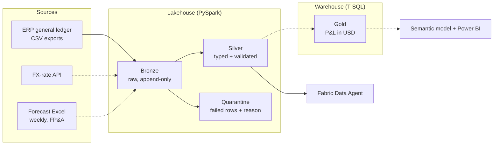

# Andes Finance Platform

A finance data platform on **Microsoft Fabric** for a fictional client, *Andes Outdoor S.A.*
(Series C, entities in Costa Rica and Colombia). It ingests ERP general-ledger data into a
validated medallion architecture, keeps bad data out of reporting, and exposes the result to
a Fabric Data Agent that answers finance questions in natural language.

Built end to end as a practice engagement: discovery, environments, ingestion, data quality,
CI/CD, operations and an agentic layer, developed day to day with Claude Code.

## Architecture



Dashed lines are on the roadmap.

**Key rule:** no row reaches Silver (and therefore reporting or the agent) unless it passes
validation. Failed rows go to a quarantine table with the reason, and the run stops entirely if
more than 5% of rows fail.

## What is implemented

| Area | Status | Details |
| --- | --- | --- |
| Environments | Done | Own Entra ID tenant, F2 capacity, `andes-dev` (Git-connected) and `andes-prod` |
| Bronze ingestion | Done | `nb_bronze_erp`: raw CSVs to Delta, all columns as text, audit columns |
| Silver + data quality | Done | `nb_silver_erp`: typing, row hash, dedupe, validation, quarantine, MERGE, watermark |
| Reusable library | Done | `andes_lib` packaged as a wheel and installed through a Fabric Environment |
| CI | Done | GitHub Actions runs `ruff` and `pytest` on every pull request |
| Data Agent | In progress | Agent over Silver with versioned instructions and an evaluation set |
| Gold + P&L report | Planned | Warehouse layer consolidated in USD |
| Forecast Excel ingestion | Planned | Schema validation and versioned snapshots |
| CD to production | Planned | `fabric-cicd` deployments with environment parameters and approval |

## Data quality results

Test data is generated with deliberately planted errors (`scripts/generate_erp_data.py`):
unbalanced journals, lines with non-existent accounts and retroactive adjustments to closed
periods.

| Check | Result |
| --- | --- |
| Rows read from Bronze (two loads of the same file) | 4,474 |
| Rows after deduplication | 2,237 |
| Valid rows promoted to Silver | 2,224 |
| Rows quarantined (non-existent account, unbalanced journal) | 13 |
| Late adjustments | Flagged with `is_late_adjustment`, not quarantined |
| Re-run with no new data | 0 rows processed, Silver unchanged (idempotent) |

Late adjustments are valid accounting, so they are flagged for visibility instead of being
rejected.

## Repository layout

```
workspace/        Fabric items serialized by Git integration (managed from Fabric)
andes_lib/        Reusable library: audit columns, dedupe, finance checks
tests/            pytest suite with a local SparkSession
scripts/          Test-data generator
docs/             Discovery, Data Agent instructions and evaluation set, agentic log
infra/            ARM template for the Fabric capacity
.github/workflows CI pipeline
CLAUDE.md         Project context and working rules for coding agents
```

`workspace/` is written by Fabric through Git integration; everything else is developed
locally and merged through pull requests.

## Local development

Requirements: Python 3.11+, Java 17 (for local PySpark tests).

```bash
python -m venv .venv && source .venv/bin/activate
pip install -r requirements-dev.txt
python scripts/generate_erp_data.py   # writes test data to data/erp/
ruff check .
pytest
python -m build                      # builds the andes_lib wheel for the Fabric Environment
```

## Agentic development

The project is built with Claude Code as a daily engineering tool:

- `CLAUDE.md` gives the agent the architecture, naming conventions, finance rules and hard
  limits (never touch `andes-prod`, never write secrets, every change through a PR).
- Every change, human or agent-written, goes through the same CI checks.
- `docs/agentic-log.md` records what was delegated, what worked and where the agent was wrong.

## Fabric Data Agent

The agent answers questions over the Silver layer. Its instructions, example queries and an
evaluation set with ground-truth SQL are versioned in `docs/data-agent/`, so changes to the
agent are reviewed and measured like code.

## Cost management

The platform runs on an F2 capacity that is paused when idle, with an Azure budget alert.
Spark sessions use a short idle timeout because an F2 supports very limited Spark concurrency.

## Roadmap

- Gold layer in the Warehouse and P&L report (actual vs forecast, USD)
- FX-rate API and forecast Excel ingestion
- Continuous deployment to `andes-prod` with `fabric-cicd` and approval gates
- Monitoring, runbooks, incident simulations and a disaster-recovery test
- Variance-commentary agent built on top of the Data Agent

---

Built by Ana Recio.
